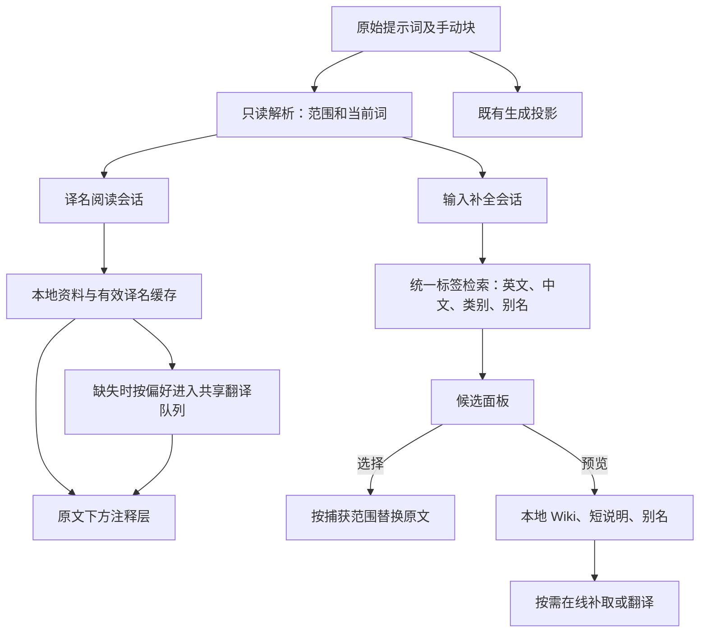

# 普通文本提示词翻译与补全改造计划

日期：2026-10-23。状态：P0–P5 已完成，源码、回归与 Windows Release 已验证（2026-10-24 更新）。

目标仓库：`AgIzT/W.O.F_NAI_Launcher`，调查基线 `19330c13`。参考仓库：相邻 `Plana-App`，基线 `45b7f9b`。

本文第 1–6 节保留调查结论与设计约束；用户随后授权完成实施和补齐环境。实际实现、验证证据和环境记录见第 7–8 节。整个验证使用隔离数据、合成模型响应与生成替身，没有请求真实生图或读取用户草稿。

用户已明确：旧翻译块数据没有必须保留或适配的需求。本计划取消旧翻译块的数据迁移、兼容解码、旧译文保留和回退机制，将旧功能完整退役，避免新旧翻译体系并存。普通文本、手动积木、随机块及独立标签/Wiki 缓存仍属于当前功能。

## 1. 目标与产品行为

提示词继续以普通文字编辑。译名附着在对应英文下方，参考 Plana 的注释式显示；输入、移动光标、选择文字、删除、复制、查找替换、撤销重做均使用原编辑器。翻译只更新阅读信息，不能把原文替换成翻译块或私有 marker。

本次范围：

1. 主提示词、负面提示词、角色正向/负向及其全屏编辑器共用新的阅读层。
2. 输入时提供中英文标签与角色搜索，角色、作品、普通标签可分组筛选；选择后插入英文标签。
3. 候选展示译名、类别、热度，并提供独立 Wiki 预览入口，预览包含简释义/摘要、别名和来源链接。
4. 已有译名与本地中文资料自动显示；缺失译名按既有用户模型配置和自动调用偏好补齐。
5. 取消翻译操作自动创建 TranslationPill；保留手动积木、随机块、块库及其生成语义。
6. 移除旧翻译块专用模型、创建/显示/编辑/序列化分支及残余入口；所有现役入口统一接新阅读层，旧翻译块不列入支持格式。

交互决策：

- 新增独立“显示译名”和“输入补全”开关；显示已有译名与是否调用 AI 分开。默认显示本地可用译名，AI 自动调用沿用用户既有偏好。
- 新输入补全只在提示词编辑器启用。现有 Ctrl+点击/拖选详细搜索继续作为高级入口；图库搜索、黑名单等其他标签框保留原提交行为。
- 补全中点击行或按 Enter/Tab 表示选词，眼睛/信息按钮表示预览，Esc 关闭。中文输入法组词期间不抢 Enter/Tab，提交组合文本后再发起新查询。
- 原“翻译”工具按钮改为译名显示、补齐缺失和重试等阅读操作。若保留全文自然语言翻译入口，结果采用独立只读对照，只有明确的替换操作才可改原文，不再调用建块路径。
- 图库与在线详情的只读提示词随后复用阅读层；远程翻译仍沿这些页面原有的显式触发边界，不因滚动浏览图片就请求全文翻译。

## 2. 已核实的现状

### 2.1 自动块化发生在“翻译”，普通输入原本就是文本

调用链：

```text
generation_wiring.onTranslate
  → PromptTranslationCoordinator.translate
  → PromptTranslationBatch.prepare
  → PromptAssistantService.translatePromptGroup
  → PromptTranslationBatch.buildFromGroups
  → workspace.replaceIfCurrent
```

`prepare` 按逗号/换行准备片段，模型将相邻片段分组；`buildFromGroups` 为每组创建 `TranslationPill`，再把原文区间替换成 marker。

关键证据：

- `lib/presentation/wiring/generation_wiring.dart:302`：翻译按钮接线。
- `lib/presentation/providers/prompt_translation_provider.dart:308`：收集文档、请求并写回分组结果。
- `lib/core/utils/prompt_translation_document.dart:73`、`:350`：准备分段与创建翻译实例。
- `lib/presentation/prompt_assistant/services/prompt_assistant_service.dart:272`：分组翻译协议。
- `lib/presentation/providers/pill_workspace_provider.dart:127`：普通输入只调用 reconcile；不是每次输入逗号就创建块。

### 2.2 当前有中文搜索，但没有输入即补全

现役链路为 `TagExpansionWrapper → LocalTagExpansionService → UnifiedTagRepository / TagSemanticsRepository`，可选接本地 RAG。主编辑框普通输入只会关闭已打开的详细面板；面板内独立搜索框才触发检索。旧 `CompletionOrchestrator` 仍在代码中，但未接到现役生产输入 UI。

- `lib/presentation/widgets/prompt/unified/unified_prompt_input.dart:1154`：显式标签扩展入口。
- `lib/presentation/widgets/tag_expansion/tag_expansion_wrapper.dart:231`、`:633`：编辑器监听与面板查询。
- `lib/core/tag_expansion/local_tag_expansion_service.dart:45`：合并英文、中文名称及包含匹配。
- `lib/core/tag_expansion/tag_semantics_repository.dart:114`：已有中文核心词/同义词检索。
- `lib/core/autocomplete/prompt_token_parser.dart:14`：当前词解析与替换可复用，但要增加适合“光标左侧输入”的契约。

中文链路的具体缺口：

1. `tag_expansion_providers.dart` 用 `catalog.byNames(searchNames(...))` 回查，语义条目若只对应主库的别名会被漏掉。
2. `byNames` 没有装配 aliases，中文候选缺失完整别名。
3. 当前排序只把“核心中文名完全相同”放前面，其余同义词精确/前缀/包含混在一起按热度排列。
4. 角色/作品已有类别映射，但当前结果混排，没有专门分组和类别筛选。
5. 现有详细搜索的插入是“插入到当前词后”；输入补全需要单独实现“替换正在输入的当前范围”。

### 2.3 数据与翻译设施足够支撑第一版

以下为随包真实 SQLite 的只读计数，不包含用户运行时更新库：

| 数据 | 数量 |
|---|---:|
| `tag_catalog.db` 标签 | 221,787 |
| `tag_catalog.db` 别名 | 71,504 |
| `tag_semantics.db` 中文语义资料 | 53,860 |
| `tag_wiki.db` Wiki 词条 | 141,802 |

中文资料按 canonical 名称直接覆盖当前主库 47,181 项，其中角色 19,316/40,931、作品 5,041/9,478。其余语义资料需进一步解析可信别名，不能假定全部直接属于当前主库。普通中文名称检索无需模型；任意自然语言场景语义搜索仍取决于可选 RAG 和其索引。

已有设施：

- `TagSemanticsRepository.find/findAll/searchNames`：核心中文名、中文同义词、简释义；包含用户补充资料。
- `TagWikiRepository.find/findAll`：本地英文正文与来源 URL。
- `TagTranslationGlossary.sourceDefinition`：从正文提取短说明，可用于第一屏预览。
- `DanbooruApiService.getWikiPage`：本地缺失时可选在线补取，支持取消、404/410。
- `AutoTagTranslationController`：按可见 surface 调度、最多五并发、名称与 Wiki 任务、路由/语言隔离、失败重试。
- `VisibleTagTranslationCache`：已持久化译名、短说明、Wiki 译文，记录语言、路由、版本、原文 hash。
- `PromptAssistantService`：现有 tagTranslate 与 wikiTranslate 模型分配和请求记录。

第一版复用这些数据和接口。Plana 的私有 `/api/tags/*` 不是本计划的运行依赖，其 127,519 条离线库也无需再打包一份。实现以 W.O.F 现有代码为基础，参考 Plana 的交互与数据流；现有数据继续保留各自来源声明。若后续扩充词库，单独登记来源锁、哈希、版本和许可，不恢复已退役 ffdkj/translation.db 预构建包。

## 3. 设计方案



### 3.1 原文与译名分离

新增轻量 `PromptReadingSession` / `PromptAnnotationSpan`（建议名），记录编辑器 scope、文本版本、原文范围、canonical tag、译名及状态。范围只来自当前文本解析，不作为长期持久化位置；异步到货必须复核文本版本。

阅读会话只发布显示状态，不调用 workspace `_apply`、`replaceIfCurrent`，不递增草稿 revision，不写生成参数和撤销栈。旧 `insertTranslationAt` 随翻译块链路退役。翻译缓存使用现有标签/Wiki 缓存服务，避免创建第三套译名数据库。

解析复用 `NaiPromptSyntax` / `PromptTokenParser` 的规则，补齐只读 range 提取：

- 识别多词标签、下划线/空格、大小写、NAI 括号与数值权重、换行。
- 保留角色名 `character_(work)` 中具有词义的括号。
- 手动 marker、别名宏、随机块作为明确边界处理，不在其内部偷偷改写。
- 对标签名称做独立归一，不把归一后的字符串写回用户原文。
- 自然语言段落不要求分组成标签；找不到可靠标签范围时保持原文，可走独立全文阅读操作。

显示层接在 `UnifiedPromptInput` / `ThemedInput` 周围，优先使用真实 EditableText/RenderEditable 的选择范围几何，和实际滚动、字体、padding、手动 WidgetSpan 一致。为译名预留行高，处理碰撞、换行和裁剪。译名不进入 controller.text，也不把每个标签包装为新的 WidgetSpan。先做小范围布局原型，确认此路线与当前手动块兼容后再推广。

### 3.2 一个阅读出口，复用现有调度

读取顺序：现有独立标签缓存中当前语言的有效译名 → 对应语言可用的随包资料 → 缺失时按用户设置调用模型。旧 TranslationPill 与块库 readingTranslation 元数据不作为新阅读层的数据来源。简体中文资料不能冒充日文/韩文译名，繁体沿现有语言转换规则处理。

扩展现有控制器的任务目的，区分“提示词只需名称”和“详细资料补充”：

- 编辑器只需要译名时，已有可用名称就结束；不能因为语义字段不完整而触发额外补充模型请求。
- 读取多标签资料采用批量查询、内存缓存和可见范围更新，避免每个标签/每个按键重开数据库。
- 多个编辑器用独立 surface 注册，共享同 canonical、同语言、同路由的在途请求与结果。
- 延续路由 epoch、缓存 generation 和明确失败状态；清缓存、切模型、换语言后旧结果不能回填。
- 第一版沿用现有并发控制。若基准证明批量翻译有收益，再在同一调度/缓存中添加 batch 适配；不并行启用旧 LlmTranslationResolver 造成重复请求。
- 无模型配置、自动 AI 关闭或断网时，本地译名照常显示，未知项安静留空，不持续转圈。

### 3.3 输入式补全

新增按编辑器隔离的 `PromptCompletionController/Wrapper`（建议名），调用改造后的统一本地检索服务，不整体复活无人使用的旧补全工厂。

- 中文至少一个已提交汉字，英文至少两个字符，约 250ms 防抖。
- 普通候选初始上限建议 12–20；单字查询严格有界。
- 本地结果先显示。RAG 留在显式高级搜索/明确增强操作，不随每次键入启动模型和大索引。
- 可选在线补全作为后续增强，失败时保留本地结果；网络源必须按编辑器隔离取消，避免多个角色框互相取消。
- 下拉按标签/角色/作品分类，支持类别筛选。分类来自当前 authoritative catalog；兼容现有 e621 映射。
- 中文结构化命中携带 core/synonym、exact/prefix/contains 证据；排序先匹配质量，再当前热度，不能让热门包含项压过精确名。
- 先匹配真实 canonical，再解析唯一可信 alias；歧义不擅自合并。只在别名表存在的旧名能解析，旧、新名均为真实 canonical 时保持各自身份，除非有可靠重定向证据。
- 为所有候选批量装配别名和中文显示；中文同义词与官方英文别名分开。
- 查询序号、文档版本、scope、光标范围共同校验；异步丰富结果不能移动用户已选中的行。
- 中间编辑用光标左侧前缀查询，选中后替换当前标签的完整内容范围，保留权重外壳和逗号分隔的后续标签。例如 `lo|ng hair, blue eyes` 查询 `lo`，选词不会残留 `ng hair`。一次选择只写入一次原生编辑值，撤销仍遵循编辑器的原生分组规则。
- 失焦、Esc、切换字段/角色、关闭面板使旧请求失效；打开详细搜索时暂停自动补全，避免双层面板抢键盘。

### 3.4 Wiki 摘要与别名

候选不批量拉取或翻译 Wiki 全文。点击预览或稳定悬停后：

1. 先显示缓存短说明/本地 semantic summary；明确来源是词库简释义。
2. 查询本地 Wiki，使用已有正文摘录工具生成简短预览，保留 Danbooru 原文入口。
3. 展示 canonical 别名和中文同义词，控制预览长度，可展开更多。
4. 本地无正文时，按在线设置复用 `getWikiPage`，做请求去重、取消和有限期负缓存；网络失败不能缓存成永久无词条。
5. 只有用户打开全文或明确请求翻译才调用 Wiki 正文翻译。模型结果异步更新阅读，不影响输入焦点、原文和候选顺序。

现有 `_wikiChunks` 是长文网络请求分批，与提示词自动切块无关，继续保留。数据缺失、网络不可用和翻译失败分别展示，不编造词条。

## 4. 旧翻译块完整退役

旧翻译块数据不属于兼容目标。删除旧机制专有代码，当前提示词只通过新阅读层提供翻译。保留 `PillDocument` 中普通文本与手动/随机块的现行能力，移除其中翻译块专用字段和分支。

清理范围：

1. **模型与存储**：移除 `TranslationPill` 及其专用序列化、显示切换、needsReview、反向编辑与还原逻辑；清理仅为译块服务的 `readingTranslation*` 元数据读写。现有独立标签/Wiki 缓存继续使用。
2. **分组与请求协议**：删除 `PromptTranslationBatch` 的译块构造、仅供此功能使用的分组 prompt/校验，以及 `translatePromptGroup` 的退役调用。共享模型传输、配置、语言和术语服务按真实依赖保留。
3. **界面与动作**：删除翻译块 widget、专用编辑窗、原译文切换、还原/撤销还原等旧菜单；主/负/角色/全屏/图库详情统一接新阅读操作，不保留旧模式开关。
4. **块库与拖动**：删除 `insertBlockAt` 根据阅读元数据自动创建译块的分支、`insertTranslationAt` 和跨编辑器译块拖动协议。用户主动插入的普通手动块仍走原块库功能。
5. **恢复与外部入口**：检查工作区、Krita bridge、Agent 快照/撤销、导入/导出，只保留当前文档能力，移除旧译块专用处理；不增加旧数据转换适配器。
6. **收尾**：删除无引用的 provider、设置键读写、菜单文案、导出和专用测试/夹具；仍有共享用途的组件按职责重命名或拆分，不能留下失效开关和空壳服务。

旧翻译块记录使用应用通用的未知/无效数据处理，不额外实现原文展开、旧译文搬运、隐藏兼容实例、迁移版本号或专用备份/回退流程。若通用加载边界无法安全跳过未知结构，应明确提示数据不受支持并拒绝使用该记录，不猜测恢复内容、不把未知 marker 发给生成接口。

退役不需要批量删除用户目录或重置整个工作区。普通文本、手动/随机块与用户设置继续按现有格式运行。实施中若要实际修改用户提示词/草稿，仍遵守仓库已有的备份和最新值核对规则；这不构成旧翻译块兼容方案。

完成标准是：生产调用图中只剩新阅读链路；旧译块专用符号无残留引用；设置、界面、模型协议、持久化和恢复入口一致，不依赖“旧功能暂时关掉”来完成改造。

## 5. 实施阶段与完成标准

| 阶段 | 工作与主要文件 | 完成标准 |
|---|---|---|
| P0 布局与不变量原型 | 新只读 range 解析/注释层；`unified_prompt_input.dart`、`themed_input.dart`、`nai_syntax_controller.dart` 接口 | 一组普通标签、权重、多行、中文组词、手动块可显示行下译名；译名更新前后 text/selection/undo/projection 不变 |
| P1 统一标签阅读 | 新阅读 facade/session；复用 `auto_tag_translation_controller.dart`、`visible_tag_translation_cache.dart`、`tag_semantics_repository.dart` | 本地/缓存优先，显示与 AI 开关分离；多 scope 去重；无模型/离线可用；只需名称不触发全资料补充 |
| P2 输入补全与中文修复 | 新补全 controller/popup；`prompt_token_parser.dart`、`completion_models.dart`、`tag_expansion_providers.dart`、`unified_tag_repository.dart` | 中英搜词、角色/作品分类、中文别名解析、稳定排序、范围替换和一次撤销通过；详细搜索仍可用 |
| P3 Wiki 预览 | 复用 `tag_wiki_repository.dart`、`tag_translation_glossary.dart`、`wiki_tag_preview.dart`、Danbooru API | 本地摘要与别名先显示；按需在线/全文翻译；失败可重试且不阻塞编辑 |
| P4 替换入口并退役旧译块 | `generation_wiring.dart`、`generation_data_wiring.dart`、`prompt_translation_provider.dart`、旧 prompt_input、详情接线、译块模型/widget/存储/拖动/恢复分支 | 常规翻译入口只更新阅读状态；主/负/角色/全屏一致；旧译块专用代码退出生产链路，无兼容模式 |
| P5 清理与交付回归 | 清理无引用代码、设置、文案、测试夹具；验证 workspace、手动块、bridge/Agent 当前契约及五语言界面 | 只有一套提示词阅读机制；普通文本与手动块生成内容不变；无旧菜单/失效开关/无用适配层；生成替身测试通过 |

依赖顺序：P0 → P1 → P2/P3 → P4 → P5。P0 是首个可评审成果：先证明“普通文字 + 译名”可用，再扩大接线。P2 和 P3 在 P1 契约稳定后可并行实施。

第一版不需要更换 Flutter 状态管理、引入新数据库引擎、重建 RAG 全库或增加固定第三方后端。必要的搜索索引优化由实际查询和布局基准决定。

## 6. 验收矩阵

### 编辑器

- `1girl, long hair, blue eyes` 显示译名，原文仍可逐字符编辑。
- `{long hair}`、`[blue eyes]`、`1.2::long hair, blue eyes::`、角色作品括号、换行、emoji/UTF-16 边界、宏和手动块均不破坏。
- 开关译名、译文到达、打开 Wiki 不改变 controller.value、草稿 revision、撤销栈、生成参数。
- 中文组词、光标中间输入、快速删除、撤销重做、查找替换、权重滚轮正常。
- 主框、负面、两个角色框及全屏独立取消和更新；角色删除后旧响应不回写。

### 搜索与预览

- `long ha` / `长发` → `long_hair`；`初音` / `初音未来` / `hatsune mi` → `hatsune_miku`，归角色。
- 核心词/同义词 exact 优先于高热度 contains；作品与角色可分别筛选。
- 旧名只在 aliases、旧新名均在 tags、歧义 alias、中文资料不在主库等情况都有明确行为。
- 中文候选仍带完整英文别名；别名不会被误当作中文同义词或 Wiki 原文。
- RAG 未开启、模型未配置、断网时，本地中英搜词及已有译名可用。
- 无 Wiki、404、超时、切换条目、关闭浮层和清缓存时均无过期回填。

### 退役清理与生成

- 普通文本、禁用角色、手动/随机块、重复手动 marker 等现役文档的生成投影保持正确；不为旧译块迁移建立验收或新增测试体系。
- 工作区、块库插入、跨框拖动、桥接快照和 Agent 撤销/恢复均无旧译块创建/专用适配分支。
- 旧译块的模型、UI、provider、协议、设置与文案无生产引用；未知结构由通用加载校验处理，未知 marker 不得泄漏到生成请求。
- 阅读译名永不进入复制原文、token 计数、生成请求和 Krita 桥接参数。
- 所有自动化验证使用隔离数据、假模型和生成替身，不请求真实生图。

### 现有测试与新增覆盖

复用 `test/core/autocomplete/`、`test/core/wiki/`、`test/core/tag_expansion/`、`test/presentation/widgets/tag_expansion/` 及现役 prompt widget/provider 测试；新增 range 解析、注释几何、输入补全会话隔离和原文/生成投影隔离测试。旧译块专用测试随功能删除；共用测试改为验证普通文本与手动块当前契约。现有显式搜索 `typing stays quiet` 用例继续限定该 wrapper，新自动补全用独立测试表达，不能误改所有标签输入框行为。

按 AGENTS 的生成接线要求，最终执行：

```text
test/presentation/wiring/generation_backend_test.dart
test/presentation/wiring/generation_settings_test.dart
test/presentation/wiring/generation_view_mapping_test.dart
test/presentation/wiring/generation_editor_wiring_test.dart
test/presentation/wiring/generation_comfyui_import_test.dart
test/presentation/providers/krita/bridge_draft_version_test.dart
```

界面验证使用真实字体，覆盖简中/繁中/英文/日文/韩文、明暗主题、窄宽窗口、不同字号、长提示词、滚动和混合手动块。性能记录冷/热本地检索、可见标签批量读取、输入帧耗时与长文滚动；不把 Python SQL 时间当作 App 性能结论。

## 7. 实施结果与环境

- 调查开始时两个仓库均干净。Plana 保持参考用途；本次业务代码、测试与文案只修改 W.O.F，不合并上游提交，不复制 Plana 的代码或数据库。
- 本机已补齐 Flutter 3.47.7 / Dart 3.13.5，SDK 位于工作区 `.toolchains/flutter`。安装 Visual Studio Build Tools 2022 的 C++、Windows SDK、ATL，以及 NuGet。用户已开启开发者模式。
- 测试在 `W:/W.O.F_NAI_Launcher` 运行，`W:` 映射当前工作区，避开 Flutter shader 编译器对中文源码路径的限制。Windows 原生构建使用 `D:/wof-build-01a1692d` 的独立源码快照，避免 cargokit 的 PowerShell 路径解析错误；没有移动原仓库。
- SDK 的 `pub get` 仅调整 5 个锁定依赖：intl 0.20.3、matcher 0.12.20、meta 1.19.0、test_api 0.7.12、vector_math 2.4.3；没有升级业务依赖。
- 数据文件已确认是 SQLite，不是 LFS pointer；第一版复用当前版本，不为此任务重建/下载整库。
- 依赖/生成输入/国际化变更按 AGENTS 与 DEVELOPMENT 的定向命令处理。台湾正体资源走现有生成器。
- 交付包含：源码、必要生成文件、针对性测试结果、界面验证证据、旧功能清理清单、更新后的用户文案；说明旧翻译块格式退出支持，不提供数据迁移。发布或安装另按用户后续授权和现有交付流程执行。

实际实现如下：

| 阶段 | 结果与入口 |
|---|---|
| P0 | `PromptTokenParser.annotationRanges` 提取原文范围；`PromptReadingLayer` 用真实 RenderEditable 几何绘制译名，监听内部及祖先滚动并裁剪可见范围。没有长期持久化范围或额外编辑文档。 |
| P1 | 扩展现有 `AutoTagTranslationController.observeNames` / `TagReadingIntent.nameOnly`，批量读本地资料与缓存并共享请求。`PromptReadingPreferences` 分离译名显示和输入补全，AI 仍复用既有全局设置。 |
| P2 | 独立 `PromptCompletionController/Wrapper`；250ms 防抖、IME 排除、原生一次赋值，按标签/角色/作品筛选。中文检索保留匹配证据；canonical 优先、唯一 alias 其次，当前分类在 SQL 的 LIMIT 之前过滤。 |
| P3 | `PromptCompletionPreview` 仅在打开预览时读取本地 Wiki/摘要，再按设置补取网络正文，保留来源、英文别名、中文同义词和错误重试。 |
| P4 | 主/负面/角色/全屏接同一阅读组件；图库详情显式打开阅读。独立全文阅读只返回文本，已移除分组、反向编辑、翻译块模型、组件、provider、拖动和恢复分支。 |
| P5 | 设置与五语言文案同步更新；旧专用测试删除，共用文档、手动块、Krita、Agent 和界面测试改为当前契约。旧翻译外观及菜单退出，没有旧格式迁移层。 |

## 8. 验证记录（2026-10-24）

- 生成工具 `dart run tool/generate.dart` 已执行；台湾正体资源由 `UPDATE_ZH_TW=1 flutter test --no-pub test/l10n/zh_tw_resources_test.dart` 生成，再执行 `flutter gen-l10n`。
- 必需的 6 个生图接线测试，加阅读层及真实编辑器集成测试，共 142 项通过，日志 `build/final-editor-tests.log`。覆盖开关/异步译名不改 controller、草稿 revision、角色文本和生成参数，以及查找替换、原生撤销、手动块、内外层滚动和高级搜索互斥。
- 第一轮完整扩展回归的失败已逐项修正：普通手动块高度、独立词库夹具、按钮新语义、Tooltip 命中及本机 Node 路径。已删除 UI 对应的历史黄金图仅排除精确受影响区域，未重录或扩大放宽整张图；修复组 132 项及黄金图/Agent 组 79 项通过。
- 五语言明暗译名实绘：`build/test_captures/reading-*.png`；五语言宽窄补全与 Wiki 预览：`build/prompt-completion-qa/*.png`。这些是合成数据的真实组件实绘，不是用户窗口截图。混合手动块、不同字号与长文滚动均有覆盖。
- 完整扩展回归 3,026 项全部通过，覆盖所有修改过的测试以及 `test/core/autocomplete`、`test/core/wiki`、`test/core/tag_expansion`、`test/presentation/widgets/prompt`、`test/presentation/providers/krita`、`test/presentation/ui` 和繁体资源；日志 `build/verified-expanded-tests.log`，输入列表 `build/final-suite-files.txt`。独立截图采集已完成；完整回归不设置全局 `CAPTURE_STUDIO_UI`，避免旧测试在 fake async 中等待系统字体文件 IO。
- 最终 6 个必需接线文件与真实随包词库验收共 120 项通过，日志 `build/verified-required-tests.log`。实际数据验证 `long ha` / `长发`、`hatsune mi` / `初音` / `初音未来` 的候选与角色分类。这些与上面的扩展测试有重叠，不累加为独立用例总数。
- `dart analyze --format machine` 无诊断；`git diff --check` 通过。对生产源码、依赖锁及 runner 的 1,526 个文件逐一核对，原仓库与构建快照内容一致。生产、测试及工具中旧翻译块专用符号检索为零。
- 实际入口 `lib/main.dart` 的 `flutter build windows --release --no-pub --no-tree-shake-icons` 成功，Windows 数据身份脚本通过。构建仅保留第三方 WebView 插件已有的 CMake CMP0175 警告；没有修改第三方包来隐藏警告。
- 完整可运行目录：`build/prompt-reading-release-20261024/`，入口 `nai_launcher.exe`。保留目录内 DLL、`data` 等完整文件，不能仅复制 EXE。未覆盖用户安装包或启动真实账户会话，未提交或发布 GitHub 版本。
- 产物 SHA-256：`nai_launcher.exe` = `B9249BF3332137CCB8C528BCB06BC6A884E7A6F205F5FAAB24456B3FD047CEE0`；`data/app.so` = `9562B611140C802DFD1E71F0E4A147FD884F2E84C4FE63788AF4A28334EE9B01`。首次启动时发现原生增量编译保留了探针 runner 对象文件；已强制重编正式 runner，验证探针窗口名消失、窗口及安全存储插件注册导入恢复，并更新交付 EXE。

性能探针源码位于 `tool/prompt_reading_benchmark/`，原始数据为 `build/prompt-reading-native.json`。它运行 Release 原生引擎和生产输入组件，读取实际随包词库；UI 与译名均为内存合成数据，未启动应用数据迁移、账户或模型。

| 测量 | 本机结果 |
|---|---|
| 英文 `long ha` | 首查 11.7ms；5 次热查 2.2–2.6ms，返回 `long_hair` |
| 中文 `长发` / `初音` / `初音未来` | 首查约 230–255ms；热查约 220–275ms，包含 canonical/alias 解析。`初音` 还可能精确命中其他同名角色，遵循精确匹配优先。 |
| 50 标签批量本地读取 | 0.79–1.17ms |
| 输入与候选场景，5 秒 | 引擎 build P95 0.119ms、raster P95 0.976ms、total P95 2.679ms |
| 600 行滚动，5 秒 | build P95 0.858ms、raster P95 1.269ms、total P95 3.446ms；最多登记 18 个可见标签 |

首查指本进程首次查询，没有清空系统文件缓存；输入场景包含帧驱动与候选动画，不等同于单次按键延迟。引擎 FrameTiming 不是实际呈现 FPS，独立输入组件数据也不代表整个工作区同时生图的性能。真实模型端到端质量与网络可用性由用户配置的服务决定，本次使用替身验证调度、取消、缓存与失败行为。
